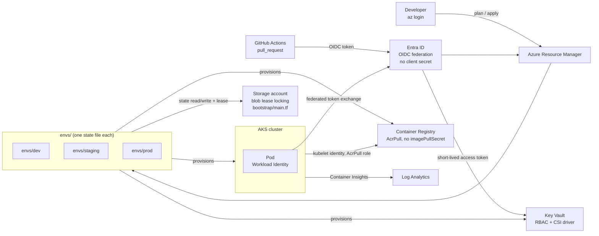

# terraform-azure-aks-platform

Repeatable, policy-gated Terraform for a production-shaped AKS platform on Azure — three
environments, one module set, zero long-lived secrets.

[](https://developer.hashicorp.com/terraform)
[](https://azure.microsoft.com)
[](https://registry.terraform.io/providers/hashicorp/azurerm/latest)
[](.github/workflows/terraform-plan.yml)
[](.checkov.yml)
[](policy/README.md)
[](LICENSE)

**Contents**

- [Cost warning](#cost-warning)
- [Why this exists](#why-this-exists)
- [Architecture](#architecture)
- [Key capabilities](#key-capabilities)
- [Quickstart](#quickstart)
- [Repository layout](#repository-layout)
- [Module catalogue](#module-catalogue)
- [Environment comparison](#environment-comparison)
- [Skills demonstrated](#skills-demonstrated)
- [What I'd do next in production](#what-id-do-next-in-production)
- [Author](#author)

---

## Cost warning

> [!WARNING]
> This repository provisions **real, billable Azure infrastructure** — VMs, a load balancer,
> NAT Gateway egress, Log Analytics ingestion, and (in staging/prod) private endpoints. Nothing
> here is covered by a perpetual free tier. If you deploy it to try it out, run
> **`make destroy-dev`** the moment you are done. CI never applies anything automatically — every
> `terraform apply`, in every environment, requires a human to pass a GitHub Environment approval
> gate first. See [docs/cost.md](docs/cost.md) for the full breakdown and the exact teardown
> sequence, including the prod gotchas (purge-protected Key Vault, `prevent_destroy` locks).

---

## Why this exists

This is a portfolio project demonstrating how I build infrastructure delivery for a real
platform team, not a tutorial repo. The goal was to answer, in code a reviewer can actually run:
how do you make Terraform **repeatable** (same modules, different `.tfvars`, no copy-paste
drift), **reviewable** (every change is a plan on a pull request before it is a diff in Azure),
**secretless** (CI and workloads authenticate with federated OIDC identities, never a stored
client secret), and **policy-gated** (a change that violates the platform's own rules fails
before it reaches Azure, and again at the Azure Resource Manager boundary if it somehow gets
there another way).

Everything below is built to be defended in an interview, not just to look good in a screenshot.
See [LEARN.md](LEARN.md) for the reasoning behind each decision, written as study notes.

---

## Architecture



This is the ten-thousand-foot view. The full topology (subnets, private endpoints, NSGs,
node-pool split), the OIDC sequence diagram, and the Workload Identity token exchange are in
[docs/architecture.md](docs/architecture.md).

---

## Key capabilities

| Capability | Implementation | File |
|---|---|---|
| Secretless CI/CD auth (OIDC) | GitHub Actions federated identity credential, matched on `iss`/`sub`/`aud` | [`bootstrap/github-oidc.tf`](bootstrap/github-oidc.tf) |
| Policy-as-code gates (Checkov + Conftest + Azure Policy) | Static HCL scan, plan-JSON OPA rules, and platform-level ARM policy | [`policy/`](policy/) |
| Drift detection | Scheduled `terraform plan` against live state; non-empty diff fails the job | [`.github/workflows/drift-detection.yml`](.github/workflows/drift-detection.yml) |
| Module reuse across environments | Same module calls, environment-specific `.tfvars` only | [`modules/`](modules/) |
| Environment isolation (separate state, separate blast radius) | One directory, one state file, one approval gate per environment | [`envs/`](envs/) |
| Workload identity (no pod secrets) | User-assigned managed identity + federated credential bound to a ServiceAccount | [`modules/identity`](modules/identity), [`kubernetes/workload-identity/`](kubernetes/workload-identity/) |
| Private networking | Purpose-separated subnets, NSGs, deterministic NAT Gateway egress, private endpoints in prod | [`modules/network`](modules/network) |
| No `imagePullSecrets` | `AcrPull` role assignment on the kubelet identity | [`modules/aks`](modules/aks) |
| Remote state locking | Native Azure blob lease — no DynamoDB-style side table | [`bootstrap/main.tf`](bootstrap/main.tf) |
| Plan-on-PR review | `terraform plan` + Checkov + Conftest run on every pull request, before merge | [`.github/workflows/terraform-plan.yml`](.github/workflows/terraform-plan.yml) |

---

## Quickstart

PowerShell (this repo is developed on Windows; PowerShell is the primary interface):

```powershell
git clone https://github.com/fakhfakhahmed/terraform-azure-aks-platform.git
cd terraform-azure-aks-platform

az login
az account set --subscription "<subscription-id>"

# One-time per subscription: creates the state backend + GitHub OIDC identity.
cd bootstrap
terraform init
terraform apply -var-file="terraform.tfvars.example"   # copy and edit first
cd ..

# Per environment.
./scripts/init-env.ps1 dev
./scripts/plan-env.ps1 dev
./scripts/apply-env.ps1 dev
./scripts/connect-aks.ps1 dev

# When you're done experimenting:
make destroy-dev
```

bash / zsh equivalent:

```bash
git clone https://github.com/fakhfakhahmed/terraform-azure-aks-platform.git
cd terraform-azure-aks-platform

az login
az account set --subscription "<subscription-id>"

cd bootstrap
terraform init
terraform apply -var-file="terraform.tfvars.example"
cd ..

make init-dev
make plan-dev
make apply-dev
make connect-dev

make destroy-dev
```

Full walkthrough, prerequisites, and troubleshooting: [docs/getting-started.md](docs/getting-started.md).

---

## Repository layout

```text
.
├── bootstrap/              # One-time, human-applied: state backend + GitHub OIDC identity
├── modules/
│   ├── naming/              # Deterministic CAF-aligned resource names + shared tag map
│   ├── network/              # VNet, subnets, NSGs, NAT Gateway, private DNS zones
│   ├── acr/                  # Azure Container Registry, private endpoint (prod)
│   ├── aks/                  # AKS cluster, node pools, AcrPull role assignment
│   ├── identity/              # User-assigned managed identities + federated credentials
│   ├── keyvault/              # Key Vault, RBAC authorisation, CSI secrets provider wiring
│   └── observability/        # Log Analytics workspace, Application Insights, diagnostics
├── envs/
│   ├── dev/                  # Composition root for dev — owns the full dependency graph
│   ├── staging/               # Same modules, staging .tfvars, one reviewer gate
│   └── prod/                  # Same modules, prod .tfvars, private cluster, two reviewers
├── policy/
│   ├── conftest/              # OPA/Rego rules evaluated against `terraform show -json`
│   └── azure-policy/          # Platform-level ARM policy definitions (management-group scope)
├── .github/
│   └── workflows/              # terraform-plan (PR gate), terraform-apply, destroy, drift, security, docs
├── kubernetes/                # Sample manifests proving the Workload Identity handoff
├── docs/                      # Architecture, cost, security, state management, ADRs
├── scripts/                   # PowerShell-first operational scripts (bash parity via Makefile)
├── Makefile                   # Single entrypoint CI and humans both use
├── .checkov.yml                # Static security gate configuration
└── .tflint.hcl                  # Linting rules (naming, docs, deprecated syntax, azurerm checks)
```

---

## Module catalogue

| Module | Purpose | Key inputs | Key outputs |
|---|---|---|---|
| `naming` | Deterministic, CAF-aligned resource names and the shared required-tag map | `prefix`, `environment`, `region`, `workload` | `names.*`, `tags` |
| `network` | VNet, purpose-separated subnets, NSGs, NAT Gateway, private DNS zones | `address_space`, `environment`, `enable_private_endpoints` | `system_subnet_id`, `user_subnet_id`, `private_endpoint_subnet_id`, `private_dns_zone_ids` |
| `observability` | Log Analytics workspace, Application Insights, diagnostic settings | `retention_in_days`, `environment` | `log_analytics_workspace_id` |
| `acr` | Azure Container Registry, optional private endpoint | `sku`, `private_endpoint_subnet_id`, `log_analytics_workspace_id` | `acr_id`, `login_server` |
| `aks` | AKS cluster, system/user node pools, kubelet `AcrPull` role assignment | `system_subnet_id`, `user_subnet_id`, `attached_acr_ids`, `sku_tier`, `private_cluster_enabled` | `oidc_issuer_url`, `kubelet_identity_object_id`, `cluster_name`, `node_resource_group` |
| `identity` | User-assigned managed identities and their federated identity credentials | `oidc_issuer_url` (from `aks`), `workloads` map | `workload_identity_principal_ids`, `workload_identity_client_ids` |
| `keyvault` | Key Vault with RBAC authorisation, role assignments for workload identities | `principal_ids` (from `identity`), `enable_private_endpoint` | `key_vault_id`, `vault_uri` |

---

## Environment comparison

| | dev | staging | prod |
|---|---|---|---|
| System pool | 1 × `Standard_B2s` | 2 × `Standard_D2s_v5` | 3 × `Standard_D4s_v5` |
| User pool | 1–2 × `Standard_D2s_v5` | 2–4 × `Standard_D4s_v5` | 3–10 × `Standard_D4s_v5` (autoscaled) |
| AKS SKU tier | `Free` | `Standard` | `Standard` |
| Availability zones | none | `1`, `2` | `1`, `2`, `3` |
| Private cluster / private endpoints | no | no | **yes** (API server, ACR, Key Vault) |
| Key Vault purge protection | off | on | on |
| Log retention | 30 days | 30 days | 90 days |
| Approval to apply | none | 1 reviewer | 2 reviewers |
| Approx. monthly cost (indicative) | **≈ €190** | **≈ €520** | **≈ €1,450** |

Cost figures are indicative, EUR, West Europe pricing, 24/7 uptime assumed — see
[docs/cost.md](docs/cost.md) for the real line-item breakdown, the NAT Gateway/Log Analytics cost
drivers, and why dev is designed to be destroyed nightly rather than left running.

---

## Skills demonstrated

**Terraform** — modules, remote state with native blob-lease locking, a workspaces-free
multi-environment pattern (directory-per-environment), `for_each`-based resource addressing,
`lifecycle` management (`prevent_destroy`, `ignore_changes`), explicit root-level composition.

**Azure** — AKS, Azure Container Registry, Key Vault, Virtual Network, NSGs, NAT Gateway, Private
Link / private endpoints, Log Analytics, Application Insights, Entra ID (Azure AD), Azure RBAC,
management-group-scoped Azure Policy.

**Identity & security** — Workload Identity federation, GitHub OIDC federation (zero stored
secrets), Azure RBAC for Kubernetes, local-account-disabled clusters, private cluster networking.

**CI/CD** — GitHub Actions, environment-gated approvals, plan-on-PR review, drift detection,
OIDC-based cloud authentication from CI.

**Policy-as-code** — Conftest / OPA evaluated against Terraform plan JSON, Checkov static
analysis, Azure Policy for defence-in-depth at the ARM boundary.

**Kubernetes** — RBAC, the Secrets Store CSI driver, system/user node-pool separation, cluster
autoscaler, Azure CNI Overlay networking.

**Governance & FinOps** — mandatory tag contract enforced by policy, environment-scoped cost
profiles, documented teardown procedures, cost-aware SKU selection per environment.

**Documentation & process** — Architecture Decision Records, a dedicated security threat model,
state-management runbooks, and this repository's own interview-prep notes in
[LEARN.md](LEARN.md).

---

## What I'd do next in production

- Align with an **Azure Landing Zone**: management groups, subscription vending, policy
  inheritance from a platform management group instead of a single subscription.
- Introduce a **hub-and-spoke network** with Azure Firewall for centralised, FQDN-based egress
  filtering once there is more than one spoke to justify its cost.
- Move plan/apply orchestration to **Terraform Cloud or Spacelift** for managed runs, policy
  sets, and run-level approval workflows instead of hand-rolled GitHub Environment gates.
- Evaluate **Crossplane** for a Kubernetes-native control-plane API over the same Azure
  resources, for teams that want to self-serve infrastructure through CRDs.
- Add **multi-region disaster recovery** — the IP address plan already reserves the ranges for a
  paired-region VNet, and ACR Premium already supports geo-replication.
- Wire up **FinOps tagging and budget alerts** through Azure Cost Management, with the existing
  mandatory tag contract (`cost_center`, `project`, `owner`) as the chargeback dimension.

---

## Author

Built by **Ahmed Fakhfakh** — [GitHub @fakhfakhahmed](https://github.com/fakhfakhahmed)

This is a portfolio project built to demonstrate senior Terraform/Azure/Kubernetes platform
engineering practice. It is not maintained as a production product; see
[docs/architecture.md](docs/architecture.md) for the known gaps and deliberately deferred work.
