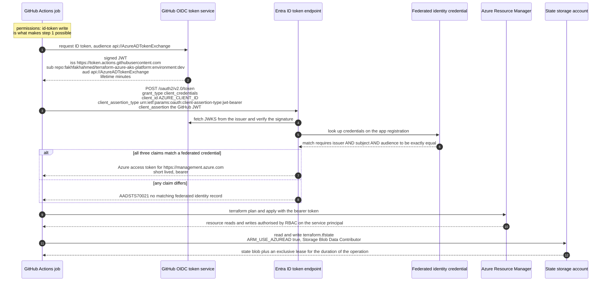
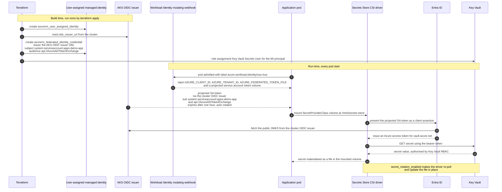
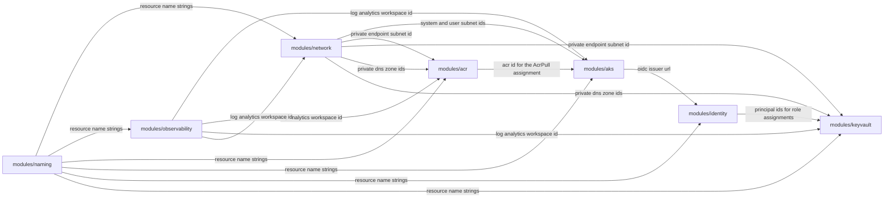

# Architecture

How `terraform-azure-aks-platform` is put together, why it is put together that way, and what
was deliberately left out.

This document assumes you have read the [README](../README.md). It is written for someone who
has to operate or extend the platform, not for someone learning Terraform.

**Contents**

- [Scope and goals](#scope-and-goals)
- [Design principles](#design-principles)
- [1. Azure resource topology](#1-azure-resource-topology)
- [IP address plan](#ip-address-plan)
- [Network design rationale](#network-design-rationale)
- [2. GitHub OIDC to Azure authentication flow](#2-github-oidc-to-azure-authentication-flow)
- [3. Workload Identity token exchange](#3-workload-identity-token-exchange)
- [Module composition](#module-composition)
- [Data flows](#data-flows)
- [Environment topology differences](#environment-topology-differences)
- [Known gaps and deferred work](#known-gaps-and-deferred-work)

---

## Scope and goals

The platform provisions, per environment, a complete Azure landing zone capable of running
production container workloads:

- a VNet with purpose-separated subnets, NSGs and deterministic egress through a NAT Gateway;
- a managed AKS cluster with a system/user node-pool split, Azure CNI overlay networking,
  Workload Identity, Azure RBAC for Kubernetes authorisation and Azure Policy admission;
- an Azure Container Registry bound to the cluster's kubelet identity, so no registry
  credential is ever stored in Kubernetes;
- a Key Vault with RBAC authorisation, consumed from pods through the Secrets Store CSI driver;
- Log Analytics plus Application Insights, with Container Insights wired into the cluster;
- user-assigned managed identities with federated identity credentials that bind Kubernetes
  ServiceAccounts to Azure identities.

It explicitly does **not** try to be an Azure Landing Zone (ALZ) accelerator. There is no
management-group scaffolding, no subscription vending, no hub VNet, no Azure Firewall. Those are
multi-team, multi-subscription concerns; this repository is a single-subscription workload
landing zone that an ALZ could later adopt.

---

## Design principles

These are the rules the code is held to. Where the code breaks one of them, there is a comment
saying why.

1. **The environment directory is the unit of blast radius.** One state file, one set of
   credentials, one approval gate per environment. See
   [ADR-0001](./decisions/0001-directory-per-environment.md).
2. **No long-lived secrets anywhere in the delivery path.** CI authenticates with OIDC
   federated credentials; pods authenticate with Workload Identity; the backend authenticates
   with Entra ID rather than a storage account key. See
   [ADR-0002](./decisions/0002-oidc-over-service-principal-secrets.md) and
   [ADR-0004](./decisions/0004-workload-identity-over-secrets.md).
3. **Modules are composable, not configurable-to-death.** A module exposes the knobs the three
   environments actually differ on, and nothing else. A `variable` that only ever takes one
   value is a constant pretending to be an interface.
4. **The environment root modules own composition; modules own resources.** No module reaches
   out to another module. All wiring is explicit in `envs/<env>/main.tf`, which means you can
   read one file and know the entire dependency graph for that environment.
5. **Prod differs from dev by configuration, not by code path.** Identical module calls,
   different `.tfvars`. The only structural difference is `lifecycle { prevent_destroy = true }`
   on stateful prod resources.
6. **Policy is enforced on the plan, not on the HCL.** Conftest evaluates
   `terraform show -json tfplan`, so it can see computed values and planned deletions that a
   static HCL scanner cannot. Checkov covers the static side; they catch different things (see
   [security.md](./security.md#ci-security-gates)).
7. **Everything that costs money is visible.** See [cost.md](./cost.md). Dev is designed to be
   destroyed nightly.

---

## 1. Azure resource topology

The diagram below shows the **prod** environment, which is the superset. Dev and staging are the
same shape with the private endpoints, private DNS zones and private API server removed, and a
different second octet (see [IP address plan](#ip-address-plan)).

```mermaid
flowchart TD
  classDef net fill:#e8f0fe,stroke:#1a73e8,color:#0b2545
  classDef data fill:#fff4e5,stroke:#e8710a,color:#3b2300
  classDef ident fill:#e6f4ea,stroke:#137333,color:#0b2e13
  classDef overlay fill:#f3e8fd,stroke:#8430ce,color:#2a0b45
  classDef ext fill:#f1f3f4,stroke:#5f6368,color:#202124

  INET["Internet and partner networks"]:::ext

  subgraph SUB["Azure subscription 00000000-0000-0000-0000-000000000000"]

    subgraph RG["Resource group rg-aksplat-prod-weu"]

      subgraph VNET["vnet-aksplat-prod-weu - 10.30.0.0/16"]
        SNSYS["snet-aks-system<br/>10.30.0.0/20<br/>nsg-aks-system"]:::net
        SNUSR["snet-aks-user<br/>10.30.16.0/20<br/>nsg-aks-user"]:::net
        SNPE["snet-private-endpoints<br/>10.30.32.0/24<br/>nsg-private-endpoints"]:::net
        SNGW["snet-appgw<br/>10.30.33.0/24<br/>RESERVED - no resources deployed"]:::net
      end

      NATGW["NAT Gateway<br/>ngw-aksplat-prod-weu"]:::net
      PIP["Public IP - Standard static<br/>pip-ngw-aksplat-prod-weu"]:::net
      SLB["Standard Load Balancer<br/>inbound only, kubernetes-managed"]:::net

      subgraph AKS["AKS aks-aksplat-prod-weu - PRIVATE cluster"]
        APISRV["API server<br/>private endpoint only<br/>azure_rbac_enabled true<br/>local_account_disabled true"]
        SYSPOOL["System node pool<br/>3 x Standard_D4s_v5<br/>zones 1,2,3<br/>taint CriticalAddonsOnly=true:NoSchedule"]
        USRPOOL["User node pool<br/>3-10 x Standard_D4s_v5<br/>cluster autoscaler<br/>zones 1,2,3"]
        KUBELET["Kubelet user-assigned identity"]:::ident
        OIDCISS["OIDC issuer URL<br/>oidc_issuer_enabled true"]:::ident
        CSI["Secrets Store CSI driver<br/>key_vault_secrets_provider addon<br/>secret_rotation_enabled"]
      end

      ACR["Azure Container Registry<br/>acraksplatprodweu - Premium<br/>admin_enabled false"]:::data
      KV["Key Vault<br/>kv-aksplat-prod-weu<br/>RBAC authorisation<br/>purge protection on"]:::data
      LAW["Log Analytics workspace<br/>log-aksplat-prod-weu<br/>90 day retention"]:::data
      APPI["Application Insights<br/>appi-aksplat-prod-weu<br/>workspace-based"]:::data

      MI["User-assigned managed identities<br/>per workload<br/>+ federated identity credentials"]:::ident

      PEACR["Private endpoint<br/>pe-acr"]:::net
      PEKV["Private endpoint<br/>pe-kv"]:::net

      DNSACR["privatelink.azurecr.io<br/>privatelink.westeurope.data.azurecr.io"]:::net
      DNSKV["privatelink.vaultcore.azure.net"]:::net
      DNSAKS["privatelink.westeurope.azmk8s.io"]:::net
    end
  end

  subgraph OVL["Overlay address space - NOT in the VNet"]
    POD["Pod CIDR 10.244.0.0/16<br/>one /24 per node<br/>NAT-ed to the node IP on egress"]:::overlay
    SVC["Service CIDR 172.16.0.0/16<br/>DNS service IP 172.16.0.10<br/>cluster-internal only"]:::overlay
  end

  SYSPOOL --> SNSYS
  USRPOOL --> SNUSR
  SNSYS --> NATGW
  SNUSR --> NATGW
  NATGW --> PIP
  PIP --> INET
  INET --> SLB
  SLB --> USRPOOL

  AKS --> POD
  AKS --> SVC

  KUBELET -->|AcrPull role assignment| ACR
  MI -->|Key Vault Secrets User| KV
  OIDCISS -->|issuer of the federated credential| MI
  CSI -->|mounts secrets from| KV

  AKS -->|Container Insights via oms_agent| LAW
  ACR -->|diagnostic settings| LAW
  KV -->|diagnostic settings| LAW
  APPI --> LAW

  PEACR --> SNPE
  PEKV --> SNPE
  PEACR --> ACR
  PEKV --> KV
  DNSACR -.->|linked to VNet| VNET
  DNSKV -.->|linked to VNet| VNET
  DNSAKS -.->|linked to VNet| VNET
  APISRV --- DNSAKS
```



### Reading the diagram

- **Nothing in the VNet has a public IP except the NAT Gateway's.** Nodes have no public IPs
  (`enable_node_public_ip = false`). Inbound traffic arrives only through the Kubernetes-managed
  Standard Load Balancer, created on demand by `Service type=LoadBalancer`.
- **Egress is deterministic.** `outbound_type = "userAssignedNATGateway"` with a single static
  Standard public IP means every packet leaving the cluster carries one known source address. A
  partner can allow-list it. Compare with the default `loadBalancer` outbound type, where the
  outbound SNAT address is an AKS-managed public IP that can change when the cluster is
  recreated, and where SNAT port exhaustion is a real and regularly-hit failure mode.
- **Pod IPs are not VNet IPs.** With `network_plugin_mode = "overlay"` the pod CIDR
  (`10.244.0.0/16`) lives entirely inside the cluster. A pod's traffic leaving the node is
  source-NAT-ed to the node's VNet IP. This is why the node subnets can be sized for *nodes*
  rather than for `nodes x max_pods`.
- **The App Gateway subnet is empty on purpose.** It exists so that adding AGIC or Application
  Gateway for Containers later does not require re-IP-ing the VNet. An empty subnet costs
  nothing.

---

## IP address plan

### Allocation rule

Each environment gets a `/16`. The only thing that varies between environments is the **second
octet**; subnet offsets are identical everywhere. That is a deliberate constraint: it means a
runbook, an NSG rule or a firewall entry can be written once with the octet as a parameter, and
it makes a misconfigured environment obvious at a glance.

| Environment | VNet CIDR | Addresses |
|---|---|---|
| dev | `10.10.0.0/16` | 65,536 |
| staging | `10.20.0.0/16` | 65,536 |
| prod | `10.30.0.0/16` | 65,536 |

The gaps (`10.11–10.19`, `10.21–10.29`) are reserved so that each environment can grow a second
VNet (for example a future hub peering, or a regional pair for DR) without colliding.

### Subnet breakdown (shown for prod; identical offsets in every environment)

| Subnet | CIDR | Range | Total | Azure reserved | Usable | Purpose |
|---|---|---|---|---|---|---|
| `snet-aks-system` | `10.30.0.0/20` | `10.30.0.0` – `10.30.15.255` | 4,096 | 5 | 4,091 | System node pool NICs |
| `snet-aks-user` | `10.30.16.0/20` | `10.30.16.0` – `10.30.31.255` | 4,096 | 5 | 4,091 | User node pool NICs |
| `snet-private-endpoints` | `10.30.32.0/24` | `10.30.32.0` – `10.30.32.255` | 256 | 5 | 251 | Private endpoint NICs |
| `snet-appgw` | `10.30.33.0/24` | `10.30.33.0` – `10.30.33.255` | 256 | 5 | 251 | Reserved for Application Gateway |
| **Allocated** | | | **8,704** | 20 | 8,684 | |
| **Free** | `10.30.34.0` – `10.30.255.255` | | **56,832** | | | Future subnets |

Arithmetic check: `4096 + 4096 + 256 + 256 = 8704`; `65536 - 8704 = 56832`. 13.3 % of the `/16`
is allocated. Azure reserves five addresses in every subnet (network address, broadcast, and
three for the platform: default gateway and two for DNS/future use), hence `usable = total - 5`.

### Why `/20` for node subnets when overlay only needs one IP per node?

Because `/20` is free and re-IP-ing is not. Concretely:

- **Today (overlay):** a `/20` holds 4,091 nodes. Prod's hard ceiling is 13 nodes
  (3 system + 10 user), plus surge capacity during upgrades. We use roughly 0.3 % of the subnet.
- **If we ever migrate off overlay** to Azure CNI with VNet-routable pod IPs, the requirement
  becomes `nodes x (max_pods + 1)`. At `max_pods = 30`, a `/20` supports
  `floor(4096 / 31) = 132` nodes. At `max_pods = 110` it supports `floor(4096 / 111) = 36`
  nodes. Both are comfortably above prod's ceiling. A `/24` node subnet would support
  `floor(256 / 31) = 8` nodes under classic CNI — i.e. it would make the migration impossible
  without renumbering.

That migration is the whole reason for the headroom. See
[ADR-0003](./decisions/0003-azure-cni-overlay.md).

### Cluster-internal address spaces

| Space | CIDR | Scope | Notes |
|---|---|---|---|
| Pod CIDR | `10.244.0.0/16` | Per cluster, **not** in the VNet | AKS allocates a `/24` per node, giving a 256-node ceiling per cluster |
| Service CIDR | `172.16.0.0/16` | Per cluster, virtual | ClusterIP range; never appears on the wire |
| DNS service IP | `172.16.0.10` | Per cluster | Must be inside the service CIDR |

**The same pod and service CIDRs are used in all three environments.** With overlay this is
safe: those addresses are never routed outside the cluster, so dev and prod can both use
`10.244.0.0/16` without any possibility of collision. The service CIDR deliberately sits in
`172.16.0.0/12` rather than `10.0.0.0/8` so that it cannot collide with a future VNet peering or
an on-premises range — a collision there would be invisible until DNS mysteriously broke.

The one caveat worth recording: if the platform ever migrates to classic Azure CNI, or needs
Private Link **to** a pod IP, the identical pod CIDRs become a problem and would have to be
split per environment. That is a known, accepted, documented debt.

---

## Network design rationale

### Why a system/user node-pool split

The system pool carries the taint `CriticalAddonsOnly=true:NoSchedule`, so only CoreDNS,
`konnectivity`, `metrics-server`, the CSI drivers and other add-ons tolerating that taint land
on it. Application pods go to the user pool.

This buys two things that matter in an incident:

1. **A runaway workload cannot evict CoreDNS.** Without the split, a memory-hungry application
   pod competing with CoreDNS on the same node produces a cluster-wide DNS outage that looks
   like a network failure and wastes an hour of diagnosis.
2. **The user pool can scale to zero or be replaced wholesale** without touching the control
   plane's companions. Node pool upgrades become a routine operation rather than a risk.

The cost is one extra node pool's worth of VMs — in dev, a single `Standard_B2s`. That is
roughly €34/month to not have a self-inflicted DNS outage class. Worth it.

### Why NAT Gateway rather than load-balancer outbound SNAT

| | Load balancer outbound (default) | NAT Gateway (chosen) |
|---|---|---|
| SNAT ports | 1,024 per node by default, statically pre-allocated | ~64,000 per public IP, dynamically shared |
| Exhaustion behaviour | Connections fail once the per-node allocation is used | Far higher ceiling; ports released after a shorter idle timeout |
| Source IP stability | AKS-managed, can change on cluster recreate | Pinned to a Terraform-managed static Standard IP |
| Partner allow-listing | Fragile | Straightforward |
| Cost | Included | ~€31/month + ~€0.042/GB processed |

SNAT port exhaustion under load-balancer outbound is one of the most common and most
mis-diagnosed AKS production failures. Paying €31/month to remove the failure mode and get a
stable egress IP is an easy call for staging and prod. It is also enabled in dev, deliberately,
so that dev reproduces prod's egress behaviour — a platform where dev and prod differ in
*networking semantics* is a platform that lies to you.

### NSGs

Each subnet carries its own NSG. The node-pool NSGs are intentionally thin: AKS itself manages a
set of rules on the cluster's NICs, and fighting it produces drift. The NSGs encode the rules
AKS will not add for you:

- deny inbound from `Internet` to the node subnets (there is no legitimate direct inbound path;
  ingress arrives via the load balancer, which bypasses the subnet NSG for its own flows);
- deny lateral traffic from `snet-aks-user` to `snet-private-endpoints` except on 443, so a
  compromised pod cannot sweep the private endpoint subnet;
- allow the AKS-required outbound set.

Pod-to-pod policy is **not** an NSG concern — that is Cilium's job (see below). Trying to express
workload policy in NSGs when pod IPs are overlay addresses is a category error; NSGs never see
those addresses.

### Network policy: Cilium in staging/prod, `azure` in dev

Staging and prod use `network_policy = "cilium"` (Azure CNI Powered by Cilium), which gives an
eBPF dataplane, identity-based policy enforcement and better observability. Dev uses
`network_policy = "azure"`.

That difference is a deliberate, uncomfortable compromise and it is worth naming: **dev does not
exercise the same dataplane as prod.** The justification is that Cilium's dataplane requires
specific node SKU/kernel combinations and interacts with the `Standard_B2s` burstable node used
in dev, and that network policy correctness is validated in staging before prod — not in dev. If
you are testing a NetworkPolicy change, test it in staging. This is written down rather than
discovered.

### Rejected: hub-and-spoke with Azure Firewall

The textbook enterprise pattern is a hub VNet containing Azure Firewall and shared services,
with workload spokes peered into it and UDRs forcing egress through the firewall.

Rejected for now because:

- **Cost.** Azure Firewall Standard is roughly €800–900/month per deployment before data
  processing. Across a portfolio-scale platform that dwarfs everything else in
  [cost.md](./cost.md) by an order of magnitude.
- **It solves a problem we do not have.** The firewall's value is centralised FQDN-based egress
  filtering and logging across many spokes. With one subscription and three workload VNets that
  never peer, the NAT Gateway gives us the deterministic egress IP we actually need, and AKS
  egress FQDN requirements are satisfied without a UDR.
- **It is additive.** Introducing a hub later means adding peering, a route table on each node
  subnet, and switching `outbound_type` to `userDefinedRouting`. None of that requires re-IP-ing
  or rebuilding the clusters, because the address plan already leaves the `10.x+1` through
  `10.x+9` ranges free.

The honest summary: this is the right architecture for one team and three environments, and the
wrong architecture for forty teams and two hundred spokes. The migration path is kept open.

### Rejected: kubenet

kubenet is in long-term maintenance and is being retired in favour of CNI overlay. It also
requires UDRs that cap the cluster at 400 nodes and complicate any future hub routing. There is
no scenario in which choosing it today is correct for a new cluster. See
[ADR-0003](./decisions/0003-azure-cni-overlay.md).

### Deferred: Application Gateway Ingress Controller

`snet-appgw` is provisioned and empty. AGIC was not deployed because:

- it adds roughly €20–25/month in fixed Application Gateway v2 capacity-unit cost per
  environment before any traffic;
- the sample workloads in [`kubernetes/`](../kubernetes/) do not need L7 WAF ingress to
  demonstrate the IaC-to-workload handoff;
- AGIC's reconciliation model (an in-cluster controller mutating a shared Azure resource) has a
  real and well-known conflict with Terraform ownership of that same resource. Adding it needs a
  deliberate decision about who owns the Application Gateway's config — a decision that deserves
  its own ADR rather than a quiet `ingress_application_gateway {}` block.

---

## 2. GitHub OIDC to Azure authentication flow

No client secret exists anywhere in this system. A workflow job proves its identity to Entra ID
using a short-lived token minted by GitHub, and Entra ID decides whether to trust it by matching
the token's `iss`, `sub` and `aud` claims against a federated identity credential created in
[`bootstrap/`](../bootstrap/).



### What is actually being trusted

Three things, and all three must match **exactly** — there is no wildcard, no prefix matching,
no regex:

| Claim | Value | Why it matters |
|---|---|---|
| `iss` | `https://token.actions.githubusercontent.com` | Pins the token to GitHub's token service. Entra fetches the JWKS from this issuer and verifies the signature. |
| `aud` | `api://AzureADTokenExchange` | Prevents a token minted for some other service (say, AWS or a container registry) from being replayed at Entra. |
| `sub` | e.g. `repo:fakhfakhahmed/terraform-azure-aks-platform:environment:prod` | Pins the token to one repository **and** one trigger context. |

The subjects created by the bootstrap stack are:

```text
repo:fakhfakhahmed/terraform-azure-aks-platform:ref:refs/heads/main
repo:fakhfakhahmed/terraform-azure-aks-platform:pull_request
repo:fakhfakhahmed/terraform-azure-aks-platform:environment:dev
repo:fakhfakhahmed/terraform-azure-aks-platform:environment:staging
repo:fakhfakhahmed/terraform-azure-aks-platform:environment:prod
```

The `environment:` subjects are the important ones. A job that declares
`environment: prod` gets a token whose `sub` is `...:environment:prod` — and GitHub will not
start that job until the environment's protection rules (required reviewers, wait timers,
allowed branches) are satisfied. The approval gate and the credential are therefore bound to
each other: **you cannot obtain a prod-capable Azure token without passing the prod approval
gate**, regardless of what the workflow YAML says.

The `pull_request` subject is scoped to plan-only operations and carries different risk. That is
discussed in [security.md](./security.md#federated-credential-subject-pinning).

### Why repository *variables*, not secrets

`AZURE_CLIENT_ID`, `AZURE_TENANT_ID`, `AZURE_SUBSCRIPTION_ID`, `TFSTATE_RESOURCE_GROUP`,
`TFSTATE_STORAGE_ACCOUNT` and `TFSTATE_CONTAINER` are stored as **variables**. None of them is a
credential. A client ID and tenant ID are public identifiers; possessing them grants nothing
without a matching federated credential or secret. Storing them as secrets would mean GitHub
masks them in logs, which actively hurts debugging (`***` in a `terraform init` error message
tells you nothing) while providing zero security benefit. Treating non-secrets as secrets is
security theatre and it trains people to ignore the distinction.

---

## 3. Workload Identity token exchange

The same federation primitive, one layer down: a Kubernetes ServiceAccount is bound to an Azure
user-assigned managed identity, and a pod using that ServiceAccount can obtain Azure access
tokens with no secret ever existing.



### The chain, stated precisely

The whole mechanism is one string matching in two places. Get the string wrong and you get an
opaque `AADSTS70021`.

1. Terraform creates `azurerm_user_assigned_identity.workload` — see
   [`modules/identity/main.tf`](../modules/identity/main.tf).
2. Terraform creates `azurerm_federated_identity_credential` with:
   - `issuer  = module.aks.oidc_issuer_url` (looks like
     `https://westeurope.oic.prod-aks.azure.com/<tenant-guid>/<cluster-guid>/`)
   - `subject = "system:serviceaccount:<namespace>:<serviceaccount-name>"`
   - `audience = ["api://AzureADTokenExchange"]`
3. The Kubernetes ServiceAccount is annotated
   `azure.workload.identity/client-id: <managed identity client id>` — see
   [`kubernetes/serviceaccount.yaml`](../kubernetes/serviceaccount.yaml).
4. The **Pod** (not the Deployment, not the ServiceAccount) carries the label
   `azure.workload.identity/use: "true"` in its pod template.
5. The mutating admission webhook (installed by `workload_identity_enabled = true`) sees that
   label and projects a service account token into the pod at
   `/var/run/secrets/azure/tokens/azure-identity-token`, plus the `AZURE_*` environment
   variables.
6. The Azure SDK (or the CSI driver) reads that file and performs the same
   `client_assertion` exchange as the CI flow in section 2, against Entra ID.
7. Entra validates the assertion against the federated identity credential by fetching the
   cluster's public JWKS from its OIDC issuer endpoint — which is why
   `oidc_issuer_enabled = true` is mandatory and why the issuer URL is public (it serves only
   public keys).
8. The returned Azure access token is used against Key Vault, Storage, Service Bus, or anything
   else the managed identity holds an RBAC role on.

**At no point does a secret exist.** There is no client secret, no certificate to rotate, no
Kubernetes `Secret` object holding a credential, and no `imagePullSecret`. The projected SA
token is valid for one hour and is rotated by the kubelet automatically.

### The two failure modes you will actually hit

| Symptom | Cause |
|---|---|
| `AADSTS70021: No matching federated identity record found` | The `subject` string in Terraform does not byte-for-byte equal `system:serviceaccount:<ns>:<sa>` as deployed. Usually a namespace typo, or the ServiceAccount was created in `default`. |
| Pod has no `AZURE_*` env vars and no token file | The `azure.workload.identity/use: "true"` label is on the Deployment metadata instead of `spec.template.metadata.labels`. The webhook only looks at the pod. |

Both are covered in the [getting-started troubleshooting section](./getting-started.md#troubleshooting).

---

## Module composition

Modules never call each other. Composition happens exclusively in `envs/<env>/main.tf`, so the
dependency graph for an environment is readable in a single file.



### Who consumes what

| Producer | Output | Consumer | Used for |
|---|---|---|---|
| `naming` | `names.*` | all | Deterministic, CAF-aligned resource names and the shared tag map |
| `network` | `system_subnet_id`, `user_subnet_id` | `aks` | Node pool placement |
| `network` | `private_endpoint_subnet_id` | `acr`, `keyvault` | Private endpoint NIC placement (prod only) |
| `network` | `private_dns_zone_ids` | `acr`, `keyvault` | Private DNS zone group on the endpoint |
| `observability` | `log_analytics_workspace_id` | `aks`, `acr`, `keyvault`, `network` | `oms_agent` and diagnostic settings |
| `acr` | `acr_id` | `aks` | `AcrPull` role assignment target |
| `aks` | `kubelet_identity_object_id` | *(inside `aks`)* | Principal for the `AcrPull` assignment |
| `aks` | `oidc_issuer_url` | `identity` | `issuer` on every federated identity credential |
| `aks` | `cluster_name`, `node_resource_group` | env outputs | `scripts/connect-aks.*` |
| `identity` | `workload_identity_principal_ids` | `keyvault` | `Key Vault Secrets User` role assignments |
| `identity` | `workload_identity_client_ids` | env outputs | Rendered into the `kubernetes/` manifests |

### The one non-obvious edge: ACR to AKS

The `AcrPull` role assignment needs two things that live in different modules: the ACR resource
ID and the cluster's **kubelet** identity object ID. Putting the assignment in the environment
root would work, but it would mean every environment repeats the same three lines.

Instead, `modules/aks` takes an `attached_acr_ids` list input and declares the role assignment
itself against `kubelet_identity[0].object_id`. This works and does not create a cycle, because
`acr` has no dependency on `aks` — the arrow only ever points one way.

The subtlety that bites people: the role assignment must target the **kubelet** identity
(`kubelet_identity[0].object_id`), not the cluster's control-plane identity
(`identity[0].principal_id`). The kubelet identity is what actually pulls images. Assigning
`AcrPull` to the wrong principal produces `ImagePullBackOff` with a 401 and a very unhelpful
error. See [`modules/aks/main.tf`](../modules/aks/main.tf).

### Ordering constraints that are real

Terraform derives most ordering from references, but two edges exist only because of a runtime
fact rather than an attribute reference, and both are handled with explicit references rather
than `depends_on`:

1. **`identity` after `aks`** — the federated credential's `issuer` is the cluster's
   `oidc_issuer_url`, which does not exist until the cluster does.
2. **`keyvault` role assignments after `identity`** — the role assignment's `principal_id` is
   the managed identity's principal ID.

There is also an eventual-consistency hazard here that no dependency graph can express: Entra ID
role assignments can take 30–60 seconds to propagate. A pod that starts immediately after
`terraform apply` may get a 403 from Key Vault that resolves itself on retry. This is not a bug
in the Terraform; it is Entra. The `kubernetes/` sample manifests set a generous
`initialDelaySeconds` for exactly this reason.

---

## Data flows

| # | Flow | Path | Authentication | Encryption |
|---|---|---|---|---|
| 1 | Developer to Azure | Laptop → ARM | `az login`, Entra interactive + MFA, Azure RBAC | TLS 1.2+ |
| 2 | CI to Azure | Runner → Entra → ARM | OIDC federated credential, no secret | TLS 1.2+ |
| 3 | CI to Terraform state | Runner → Blob Storage | Entra ID (`ARM_USE_AZUREAD=true`), `Storage Blob Data Contributor` | TLS 1.2+ in transit, SSE at rest |
| 4 | Developer to the API server | `kubectl` → AKS API | `kubelogin` + Entra device/browser flow, Azure RBAC for Kubernetes; local accounts disabled | TLS 1.2+ |
| 5 | Node to the API server | Node → private endpoint (prod) / public FQDN (dev, staging) | Cluster-managed certificates | TLS |
| 6 | Kubelet to ACR | Node → ACR (private endpoint in prod) | Kubelet managed identity + `AcrPull`, no `imagePullSecrets` | TLS |
| 7 | Pod to Key Vault | Pod → CSI driver → Entra → Key Vault | Workload Identity federated credential + `Key Vault Secrets User` | TLS |
| 8 | Pod egress to the internet | Pod → node SNAT → NAT Gateway → static PIP | n/a | Workload-dependent |
| 9 | Inbound to a workload | Internet → Standard LB → node → pod | Workload-dependent | Workload-dependent (TLS terminated in-cluster) |
| 10 | Cluster telemetry | `oms_agent` → Log Analytics | Cluster managed identity | TLS |
| 11 | Resource diagnostics | ACR/KV/NSG → Log Analytics | Platform-managed | TLS |

Flows 2, 3, 6 and 7 are the ones that would classically require a stored credential. None of
them does here. That is the point of the architecture.

---

## Environment topology differences

Same modules, same code paths, different `.tfvars`.

| | dev | staging | prod |
|---|---|---|---|
| VNet | `10.10.0.0/16` | `10.20.0.0/16` | `10.30.0.0/16` |
| System pool | 1 × `Standard_B2s` | 2 × `Standard_D2s_v5` | 3 × `Standard_D4s_v5` |
| User pool | 1–2 × `Standard_D2s_v5` | 2–4 × `Standard_D4s_v5` | 3–10 × `Standard_D4s_v5` |
| AKS SKU tier | `Free` | `Standard` | `Standard` |
| Availability zones | none | `["1","2"]` | `["1","2","3"]` |
| Private cluster | no | no | **yes** |
| Private endpoints | none | none | ACR + Key Vault |
| ACR SKU | `Basic` | `Standard` | `Premium` |
| Network policy | `azure` | `cilium` | `cilium` |
| Log retention | 30 days | 30 days | 90 days |
| Key Vault purge protection | off | on | on |
| `prevent_destroy` | no | no | yes (Key Vault, ACR, Log Analytics) |
| Approval to apply | none | 1 reviewer | 2 reviewers |
| Destroy workflow | allowed | allowed | **blocked** |

Why `Free` in dev is not just a cost decision: the `Free` tier has no uptime SLA and a lower API
server request limit. Running dev on `Free` means the team experiences control-plane throttling
in dev first, where it is an annoyance, rather than discovering it in prod. The cost saving
(≈ €70/month) is a bonus. See [cost.md](./cost.md).

Why prod's purge protection is on and irreversible: once enabled on a Key Vault, purge
protection **cannot be disabled**. A deleted vault stays recoverable for the retention period
and its name stays reserved. This is deliberate — it is the only thing standing between a
mis-targeted `terraform destroy` and permanent loss of key material. It is also why the prod
teardown gotchas in [cost.md](./cost.md#teardown) matter.

---

## Known gaps and deferred work

Honest list. These are not oversights; they are decisions with a cost attached.

| Gap | Why it is not done | What it would take |
|---|---|---|
| No hub VNet / Azure Firewall | ≈ €800+/month, solves a multi-spoke problem we do not have | Hub VNet, peering, UDRs, `outbound_type = "userDefinedRouting"` |
| No AGIC or Gateway for Containers | Ownership conflict with Terraform needs its own ADR; fixed cost per env | `snet-appgw` is already reserved |
| No Microsoft Defender for Containers | Per-vCPU cost; would be the first thing added for a real production tenant | `microsoft_defender` block + Defender plan enablement |
| No image signing / content trust | Needs a signing key custodian and an admission policy to be worth anything | Notation or cosign in CI, Ratify + Gatekeeper admission |
| No Kyverno/Gatekeeper admission control | Azure Policy for AKS covers the baseline; a second admission controller needs an owner | Helm release + policy library |
| No managed Prometheus / Grafana | Container Insights covers the demo; managed Prometheus adds ingestion cost | `azurerm_monitor_workspace` + DCR + Grafana |
| Identical pod CIDRs across environments | Safe under overlay; becomes a problem only on migration | Split pod CIDRs per environment |
| Dev uses `azure` network policy, not Cilium | Node SKU interaction; accepted and documented above | Change dev's node SKU and flip the variable |
| No DR / multi-region | Single-region by design; DR for a stateless platform is a workload concern | Paired-region VNet (address space already reserved), ACR geo-replication (Premium already) |

---

## See also

- [getting-started.md](./getting-started.md) — zero to a running cluster, and how to tear it down
- [state-management.md](./state-management.md) — the backend, locking, and recovery
- [security.md](./security.md) — threat model and what is deliberately relaxed in dev
- [cost.md](./cost.md) — what all of this costs, and how to stop paying for it
- [ADR-0001](./decisions/0001-directory-per-environment.md) · [ADR-0002](./decisions/0002-oidc-over-service-principal-secrets.md) · [ADR-0003](./decisions/0003-azure-cni-overlay.md) · [ADR-0004](./decisions/0004-workload-identity-over-secrets.md) · [ADR-0005](./decisions/0005-terraform-over-bicep.md)
