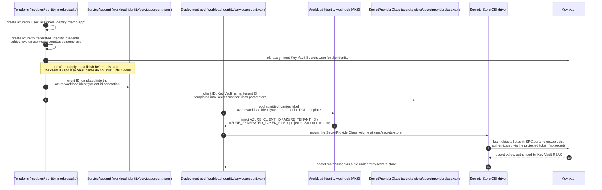

# Kubernetes manifests

Sample workload demonstrating the secretless chain described in
[`docs/architecture.md` section 3](../docs/architecture.md#3-workload-identity-token-exchange):
a pod in this cluster reads a Key Vault secret without any Azure credential ever being stored in
Kubernetes, a container image, or a CI secret.

```
kubernetes/
├── workload-identity/
│   └── serviceaccount.yaml      # Namespace "apps", ServiceAccount "demo-app", Deployment "demo-app"
├── secrets-store/
│   └── secretproviderclass.yaml # SecretProviderClass "demo-app-secrets"
└── README.md
```

---

## The end-to-end chain

Nothing in this directory grants access by itself. Every file here is a *reference* to an
identity that Terraform created; the files only wire the reference together correctly.



Read left to right, in prose:

1. **Terraform creates the identity.** `modules/identity` creates one
   `azurerm_user_assigned_identity` and one `azurerm_federated_identity_credential` per workload,
   keyed by a map whose entries carry `namespace` and `service_account_name` — for the sample
   workload, `{ namespace = "apps", service_account_name = "demo-app" }`. The federated
   credential's `subject` is built from those two fields as
   `system:serviceaccount:apps:demo-app`, and its `issuer` is `module.aks.oidc_issuer_url` — which
   only exists once the cluster does (`modules/aks` sets `oidc_issuer_enabled = true`).
2. **The ServiceAccount is annotated with that identity's client ID.**
   [`workload-identity/serviceaccount.yaml`](./workload-identity/serviceaccount.yaml) carries the
   `azure.workload.identity/client-id` annotation. This is what tells the webhook *which* Azure
   identity a pod using this ServiceAccount should become.
3. **The Deployment's pod template carries the Workload Identity label.** The label
   `azure.workload.identity/use: "true"` must be on `spec.template.metadata.labels`, not on the
   Deployment's own top-level `metadata.labels` — the webhook only inspects the Pod admission
   request. This exact mistake is the second failure mode documented in
   [architecture.md](../docs/architecture.md#the-two-failure-modes-you-will-actually-hit), and is
   called out again inline in the manifest.
4. **AKS's mutating admission webhook injects the token at pod admission.** Because
   `modules/aks` sets `workload_identity_enabled = true`, the webhook sees the pod label, projects
   a short-lived (one hour, auto-rotated) service account token into the pod, and injects
   `AZURE_CLIENT_ID`, `AZURE_TENANT_ID` and `AZURE_FEDERATED_TOKEN_FILE` as environment variables.
5. **The SecretProviderClass tells the CSI driver what to fetch and as whom.**
   [`secrets-store/secretproviderclass.yaml`](./secrets-store/secretproviderclass.yaml) names the
   Key Vault (`keyvaultName`), the tenant (`tenantId`), the same client ID as step 2 (`clientID`),
   and the objects to read (`parameters.objects`). The Key Vault Secrets Provider CSI add-on
   enabled on the cluster (`modules/aks`, with `secret_rotation_enabled`) is what actually performs
   the mount and the periodic re-poll.
6. **Secrets land as files under `/mnt/secrets-store`.** The Deployment mounts the
   `secrets-store.csi.k8s.io` CSI volume read-only at that path. This is the preferred consumption
   pattern — see the comment in `secretproviderclass.yaml` on why the optional `secretObjects`
   sync-as-Secret block exists but is not used by the sample container.

At no point does a client secret, a certificate, or a Kubernetes `Secret` holding Azure
credentials exist. The only thing that ever leaves the cluster's OIDC issuer is a public JWKS
document; the only thing that ever enters the pod is a short-lived token issued by Entra ID after
validating that projected token against the federated credential Terraform created in step 1.

---

## Apply order

**These manifests cannot be applied before `terraform apply` has completed for the target
environment.** The two placeholders they contain — the Workload Identity client ID and the Key
Vault name — are Terraform outputs (`workload_identity_client_ids["demo-app"]` and
`key_vault_name` in `envs/<env>/outputs.tf`) that do not exist until the identity and the vault
have actually been created. Applying this directory against stale or placeholder values produces
either `AADSTS70021` at the pod (wrong or missing client ID) or a CSI mount failure (wrong vault
name) — both covered in
[getting-started.md#troubleshooting](../docs/getting-started.md#troubleshooting).

The normal flow is:

1. `terraform apply` in `envs/<env>` (`../docs/getting-started.md`, Steps 9–10).
2. Read the two output values and substitute them into the placeholders in this directory. In
   this repository that substitution is deliberately small — a literal string replace via
   `envsubst`, PowerShell's `-replace`, or a Helm `values.yaml` render in CI — rather than a
   secrets-management system, because none of the substituted values is a secret (see the header
   comment in each manifest). The exact commands for dev are in
   [getting-started.md Step 11](../docs/getting-started.md#step-11--deploy-the-sample-workload-and-verify-workload-identity).
3. Apply the templated manifests:

   ```bash
   kubectl apply -f kubernetes/workload-identity/ -f kubernetes/secrets-store/
   ```

   **Substitute the placeholders first.** Applying the files as checked into git, with the
   literal strings `<AZURE_CLIENT_ID>`, `<KEY_VAULT_NAME>` and `<AZURE_TENANT_ID>` still in them,
   creates a ServiceAccount and SecretProviderClass that reference no real Azure identity — the
   Deployment will come up, but Workload Identity token exchange and the CSI mount will both fail.

See also [architecture.md section 3](../docs/architecture.md#3-workload-identity-token-exchange)
for the full mechanism and [security.md](../docs/security.md) for the threat model this design is
defending against.
